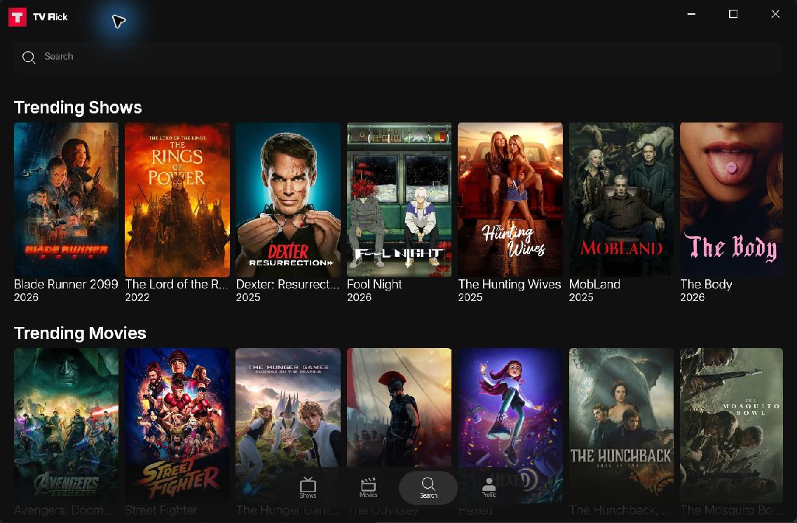
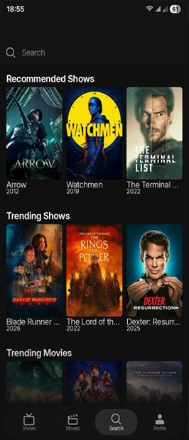

# TV Flick

[Українська](README.uk.md) · [Русский](README.ru.md) · [Polski](README.pl.md)

TV Flick is a local-first movie and TV library for Windows and Android. Track what you have watched, find your next episode, and keep a backup of your library. A Google account is optional.

## Screenshots

| Windows | Android |
| --- | --- |
|  |  |

## What you can do

| Where | What it does |
| --- | --- |
| **Shows / Movies** | Watch List shows the next released, unwatched episode for each show and counts the rest. Upcoming shows future releases. |
| **Search** | Find movies and series through TMDB or browse recommendations, trending, popular, and top-rated titles. |
| **Profile** | View watch statistics, browse your library and favorites, and filter collections by status. |
| **Properties** | Add a title to Favorites or Watch List, stop watching, reset progress, or remove a title. The checkmark lets you mark an episode or movie manually. |
| **Database / AdBlock** | Manage your own authorized sources and the optional request filter for each source. |
| **Player** | Play supported MP4 and HLS streams. Choose quality and audio when the source supplies options, change speed, use Picture-in-Picture on Android or Mini Player on Windows. Auto MARK updates the library at 70% of the title’s duration or on completion. |
| **Download** | Choose audio, then quality when alternatives are available. Windows opens Save As. Android offers compatible download apps. Download in the player uses its current selection. |
| **Backup** | Export or restore a portable `.tvbackup` or JSON. Export CSV and PDF for reading. Optional Google Drive backup uses TV Flick’s private app folder. AutoExport runs on app startup when due. |

TMDB supplies metadata and artwork. Playback connects to sources you configure. TV Flick does not host or distribute films or series. Use media you are authorized to access. Independent forks, modified builds, and third-party sources are maintained by their respective operators.

## Install

Get the binaries from [GitHub Releases](https://github.com/Gghz007/TV-Flick/releases) when a release is available.

- **Windows x64.** Extract the portable ZIP to a writable folder and launch `TV Flick.exe`. Move the whole folder to keep the `Local Database` next to the launcher.
- **Android 8.0+.** Open the APK on the device. Android updates an installed copy when its signing certificate matches.

## Build from source

Use JDK 21 and the Android SDK for Android builds. Add `tmdb.apiKey=YOUR_TMDB_KEY` to the ignored `local.properties` to enable catalog access.

```powershell
.\gradlew.bat :composeApp:run
.\gradlew.bat :composeApp:createDistributable
.\gradlew.bat :androidApp:assembleDebug
```

TV Flick uses Kotlin, Compose Multiplatform, SQLDelight/SQLite, Ktor, and MediaMP. Source discovery, playback, and request filtering are separate modules. See [Google OAuth setup](docs/google-cloud-setup.md) and [backup formats](docs/backup-formats.md).

## Privacy, terms, and credits

[Project website](https://gghz007.github.io/TV-Flick/) · [Privacy Policy](https://gghz007.github.io/TV-Flick/privacy.html) · [Terms of Service](https://gghz007.github.io/TV-Flick/terms.html) · [Report an issue](https://github.com/Gghz007/TV-Flick/issues)

Created by Gghz007 with code assistance from ChatGPT. This product uses the TMDB API but is not endorsed or certified by TMDB.

No project-wide license has been selected. Third-party components retain their respective licenses.
